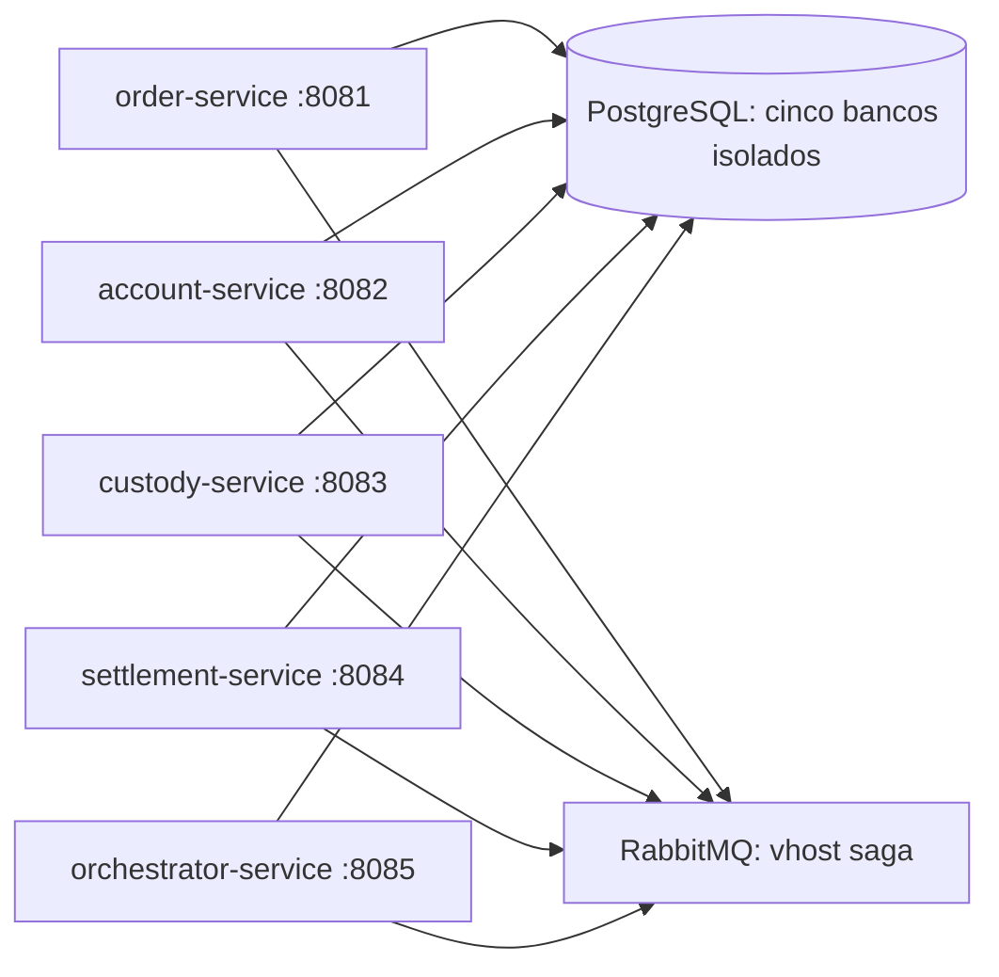

# saga-comparative-study

Estudo comparativo de Sagas para compra simulada de um ativo. A modalidade
orquestrada começa com quatro serviços de domínio e um coordenador técnico.
A coreografia será implementada posteriormente, preservando as regras de domínio.

O progresso da implementação está na [checklist da Saga orquestrada](#progresso-da-saga-orquestrada).
Os resultados detalhados e as limitações estão em [docs/progress.md](docs/progress.md).

## Organização

| Diretório | Finalidade |
| --- | --- |
| `orquestrada/` | Cinco aplicações Spring Boot e construção Maven da modalidade |
| `coreografada/` | Escopo documentado para implementação posterior |
| `compartilhado/` | Contratos e regras puras, sem persistência compartilhada |
| `infra/` | PostgreSQL, RabbitMQ e ferramentas de desenvolvimento |
| `experimentos/` | Cenários e resultados futuros, dependentes do piloto |
| `docs/` | Especificação, decisões e acompanhamento |

A [especificação original](docs/specifications/orchestrated-saga-specification.pdf)
é a referência de domínio. O [guia de preparação](docs/preparation-guide.md) foi
preservado como referência histórica da preparação. O estado atual inclui
infraestrutura executável, reservas e liquidação locais, conforme a checklist abaixo.

Código, pacotes e artefatos usam inglês. Documentação e mensagens de commit usam
português, com prefixos Conventional Commits (`chore`, `build`, `docs`, `feat`, `test`).
Branches curtas por tarefa partem de `dev` e entram por pull request em `dev`;
o conjunto aceito segue de `dev` para `main`. Excluir a feature somente após seu merge. As duas modalidades coexistem no mesmo histórico.

Estado e validações: [docs/progress.md](docs/progress.md).

## Executar o bootstrap

Pré-requisitos: JDK 17 completo (Temurin recomendado), Docker Engine/Desktop com
Compose v2 e Bash/curl. No Windows, use Git Bash com Docker Desktop em modo Linux.
Maven global é dispensável: o Wrapper baixa e verifica a distribuição 3.10.0.
Confira `java -version`, `javac -version`, `docker version` e `docker compose version`.
[Versões, checksums e ajustes para esta nuvem](docs/environment.md).

Na raiz do repositório:

```bash
# Preserva um .env que já exista.
test -e infra/.env || cp infra/.env.example infra/.env
# Edite infra/.env e substitua todos os CHANGE_ME por senhas locais distintas.
docker compose --env-file infra/.env -f infra/compose.yaml config --quiet
docker compose --env-file infra/.env -f infra/compose.yaml up -d --wait
bash infra/scripts/configure-rabbitmq.sh
bash infra/scripts/check-database-isolation.sh
cd orquestrada
./mvnw clean verify
cd ..
```

Abra cinco terminais na raiz, configurando o JDK 17 em cada um, e execute **um
comando por terminal**:

```bash
bash infra/scripts/run-service.sh order
bash infra/scripts/run-service.sh account
bash infra/scripts/run-service.sh custody
bash infra/scripts/run-service.sh settlement
bash infra/scripts/run-service.sh orchestrator
```

O script lê seu `.env` local e executa o JAR em primeiro plano. Opcionalmente,
execute `export JAVA_TOOL_OPTIONS='-Xms64m -Xmx256m'` em cada terminal; foi o limite usado
na validação do bootstrap. Não é uma recomendação de capacidade para experimentos.
Aguarde a inicialização e então, em outro terminal na raiz:

```bash
bash infra/scripts/check-health.sh
bash infra/scripts/check-database-isolation.sh
docker compose --env-file infra/.env -f infra/compose.yaml ps
```

Endpoints disponíveis em **cada** porta 8081–8085:

| Caminho HTTP | Resultado esperado |
| --- | --- |
| `/actuator/health` | HTTP 200 e status UP com dependências disponíveis |
| `/actuator/health/liveness` | Estado do processo, independente de banco/broker |
| `/actuator/health/readiness` | Inclui PostgreSQL e RabbitMQ; HTTP 503 se indisponíveis |
| `/actuator/prometheus` | Métricas em formato Prometheus |

A API `/api/ordens` registra e consulta ordens. Sua existência e a confirmação de
saúde não comprovam publicação/consumo de mensagens nem execução da Saga.

## Catálogo demonstrativo

O catálogo padrão começa vazio. Para carregar os ativos `ATV001` (10,00) e
`ATV002` (25,50), versão `demo-v1`, inicie **somente order-service** com:

```bash
SPRING_PROFILES_ACTIVE=demo bash infra/scripts/run-service.sh order
```

Use esse comando no lugar do comando normal de ordens, sem iniciar duas JVMs na
mesma porta. O seed é repetível e não sobrescreve ativos existentes. Mantenha o
perfil `demo` nos reinícios desse banco para preservar a validação do histórico
Flyway. O perfil não cria saldo nem estoque; esses seeds continuam pendentes.

## Criar e consultar uma ordem

Com o catálogo demo e order-service em execução:

```bash
curl -i -X POST http://127.0.0.1:8081/api/ordens \
  -H 'Content-Type: application/json' \
  -H 'Idempotency-Key: compra-exemplo-1' \
  -d '{"clienteId":"CLI001","ativoId":"ATV002","quantidade":3}'
# Use o orderId retornado, ou o caminho informado no cabeçalho Location:
curl http://127.0.0.1:8081/api/ordens/SEU_ORDER_ID
```

A criação retorna `202`, `Location`, orderId, sagaId, estado `RECEBIDA`, preço,
valor total e versão do catálogo. Reenvio com mesmo cliente/chave/conteúdo retorna
a ordem original; conteúdo divergente recebe `409`. Chave ausente ou entrada
inválida recebe `400`; ativo desconhecido, `422`; consulta de ordem inexistente,
`404`. A chave deve ter até 128 caracteres, sem espaços nas extremidades.
A ordem permanece `RECEBIDA` enquanto a coordenação distribuída não existir.

## Encerrar e retomar

Use `Ctrl+C` em cada terminal de aplicação. Em seguida:

```bash
docker compose --env-file infra/.env -f infra/compose.yaml down
```

Os volumes são preservados. Para retomar, execute `up -d --wait` e os cinco comandos
de aplicação novamente. **Não use `down -v` para encerrar:** ele destrói os dados.
Trocar senhas no `.env` não modifica usuários já persistidos nos volumes; consulte
[infra/README.md](infra/README.md) para o ciclo de vida da configuração.

## Progresso da Saga orquestrada

Os itens marcados representam capacidades implementadas e verificadas nesta branch,
não aprovação de PR nem funcionamento completo da Saga distribuída.

### Etapas concluídas

- [x] Preparar o monorepositório, a especificação, as convenções e a documentação de desenvolvimento.
- [x] Configurar Java 17, Maven Wrapper e as cinco aplicações Spring Boot independentes.
- [x] Configurar PostgreSQL com cinco bancos/usuários isolados, RabbitMQ, volumes e migrações Flyway.
- [x] Disponibilizar saúde, liveness, readiness, métricas Prometheus e logs estruturados.
- [x] Implementar [reservas locais de saldo](docs/decisions/0003-account-balance-reservations.md): reservar, confirmar e liberar com idempotência, transações e controle de concorrência.
- [x] Implementar [reservas locais de ativos](docs/decisions/0004-asset-reservations.md): reservar, liberar e transferir ao comprador uma única vez, preservando a posição de origem.
- [x] Implementar [liquidação local durável](docs/decisions/0005-local-settlement.md): validar reservas compatíveis, registrar uma decisão única e permitir replay e consultas por operação, ordem e Saga.
- [x] Corrigir o conflito de replay com conta inexistente e proteger as operações SQL de saldo contra valores não positivos e ausência de transação.
- [x] Validar a API e as três capacidades locais com **215 testes aprovados**, sem falhas, erros ou ignorados: 35 de ordens, 53 de saldo, 81 de custódia e 46 de liquidação.
- [x] Verificar a inicialização das cinco aplicações, saúde/readiness UP e isolamento dos bancos (cinco acessos próprios e vinte recusas cruzadas).

- [x] Implementar catálogo fixo/versionado e captura do preço no registro da ordem.
- [x] Implementar `POST /api/ordens` e consulta por `GET /api/ordens/{orderId}`, com validação e persistência do estado da ordem.
- [x] Implementar idempotência HTTP por cliente e `Idempotency-Key`: reenvio igual retorna a ordem original; conteúdo divergente recebe 409.

Os resultados acima correspondem à validação registrada em
[docs/progress.md](docs/progress.md). Os testes incluem HTTP real com PostgreSQL, replay, concorrência e rollback.
Eles não comprovam escalabilidade sob carga nem recuperação de uma Saga distribuída.
A API é local de desenvolvimento e ainda não possui autenticação/autorização;
clienteId não representa identidade autenticada. Não a exponha externamente antes
de implementar esses controles. O [contrato de ordens](docs/decisions/0006-order-api.md)
detalha idempotência, erros e limites desta entrega.

- [x] Definir o [contrato v1](compartilhado/README.md) e configurar e testar [filas, roteamento e DLQs no RabbitMQ](infra/README.md).

- [x] Gravar um único evento v1 `OrdemRecebida` na Outbox de cada nova ordem, na mesma transação da chave HTTP e da ordem. [Decisão e consulta SQL](docs/decisions/0006-order-api.md)

- [x] Publicar envelopes persistentes da Outbox e reagendar pendências até receber ACK do RabbitMQ com roteamento confirmado.

### Próximas etapas

Sequência prevista a partir da especificação; manter cada item desmarcado até sua
implementação e validação. API de ordens, catálogo e idempotência HTTP estão implementados. A próxima
etapa é consolidar a validação integrada e a documentação da mensageria (etapa 6).

- [ ] Versionar seeds de catálogo, saldo inicial e estoque configuráveis por cenário.
- [ ] Implementar consumidores idempotentes/Inbox, resultados duráveis das operações, ACK após commit, retries e DLQ para erros de contrato.
- [ ] Implementar o motor persistente da Saga, com estados técnicos, etapas, prazos e consulta restrita de diagnóstico.
- [ ] Integrar o caminho feliz: reservar saldo → reservar ativo → registrar liquidação → efetivar saldo/ativo → finalizar a ordem como LIQUIDADA.
- [ ] Implementar compensações em ordem inversa antes da liquidação, rejeitando a ordem somente após confirmar a liberação dos recursos.
- [ ] Implementar reconciliação após falhas/reinício e consulta de resultados desconhecidos; após liquidação confirmada, concluir efetivações sem compensação automática.
- [ ] Completar observabilidade do fluxo com tracing OpenTelemetry, identificadores nos logs e métricas de convergência, compensação e latência.
- [ ] Executar testes integrados de falhas C1–C6, duplicação, concorrência, crash entre commit/publicação e recuperação após liquidação, conforme o protocolo-base.
- [ ] Validar os invariantes fim a fim: ausência de reservas após rejeição, efetivações únicas antes de LIQUIDADA e identificação das Sagas não terminais.
- [ ] Preparar o piloto com cenários, seeds, versões e configurações reprodutíveis; medir carga e capacidade antes de fixar parâmetros experimentais.

A modalidade coreografada permanece uma etapa posterior, após a validação da
orquestrada, preservando as mesmas regras de negócio e critérios de comparação.

## Infraestrutura e limites



O diagrama representa conexões de infraestrutura, não um fluxo de Saga implementado.
A checklist distingue as capacidades locais já verificadas das etapas distribuídas
pendentes. Veja também a [comparação com o protótipo](docs/prototype-comparison.md)
e os [resultados e limitações](docs/progress.md).
