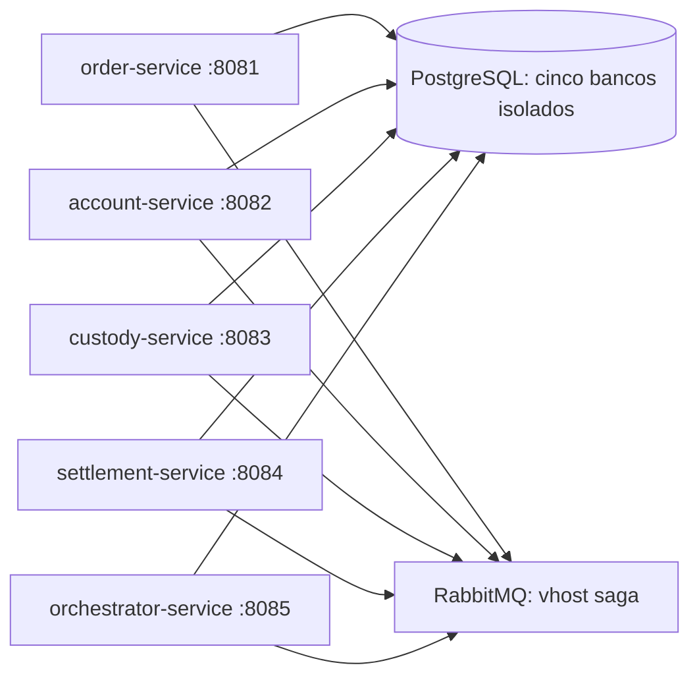

# saga-comparative-study

Estudo comparativo de Sagas para compra simulada de um ativo. A modalidade
orquestrada começa com quatro serviços de domínio e um coordenador técnico.
A coreografia será implementada posteriormente, preservando as regras de domínio.

## Organização

| Diretório | Finalidade |
| --- | --- |
| `orquestrada/` | Cinco aplicações Spring Boot e construção Maven da modalidade |
| `coreografada/` | Escopo documentado para implementação posterior |
| `compartilhado/` | Contratos e regras puras, sem persistência compartilhada |
| `infra/` | PostgreSQL, RabbitMQ e ferramentas de desenvolvimento |
| `experimentos/` | Cenários e resultados futuros, dependentes do piloto |
| `docs/` | Especificação, decisões e acompanhamento |

A [especificação original](docs/specifications/orchestrated-saga-specification.pdf)
é a referência de domínio. O [guia de preparação](docs/preparation-guide.md) foi
preservado como referência; a autorização desta tarefa amplia seu limite sem código
para permitir projetos executáveis e infraestrutura, sem implementar regras da Saga.

Código, pacotes e artefatos usam inglês. Documentação e mensagens de commit usam
português, com prefixos Conventional Commits (`chore`, `build`, `docs`, `feat`, `test`).
Branches curtas por tarefa são integradas por pull request para `main`; excluir a
branch somente após o merge. As duas modalidades coexistem no mesmo histórico.

Estado e validações: [docs/progress.md](docs/progress.md).

## Executar o bootstrap

Pré-requisitos: JDK 17 completo (Temurin recomendado), Docker Engine/Desktop com
Compose v2 e Bash/curl. No Windows, use Git Bash com Docker Desktop em modo Linux.
Maven global é dispensável: o Wrapper baixa e verifica a distribuição 3.10.0.
Confira `java -version`, `javac -version`, `docker version` e `docker compose version`.
[Versões, checksums e ajustes para esta nuvem](docs/environment.md).

Na raiz do repositório:

```bash
# Preserva um .env que já exista.
test -e infra/.env || cp infra/.env.example infra/.env
# Edite infra/.env e substitua todos os CHANGE_ME por senhas locais distintas.
docker compose --env-file infra/.env -f infra/compose.yaml config --quiet
docker compose --env-file infra/.env -f infra/compose.yaml up -d --wait
bash infra/scripts/check-database-isolation.sh
cd orquestrada
./mvnw clean verify
cd ..
```

Abra cinco terminais na raiz, configurando o JDK 17 em cada um, e execute **um
comando por terminal**:

```bash
bash infra/scripts/run-service.sh order
bash infra/scripts/run-service.sh account
bash infra/scripts/run-service.sh custody
bash infra/scripts/run-service.sh settlement
bash infra/scripts/run-service.sh orchestrator
```

O script lê seu `.env` local e executa o JAR em primeiro plano. Opcionalmente,
execute `export JAVA_TOOL_OPTIONS='-Xms64m -Xmx256m'` em cada terminal; foi o limite usado
na validação do bootstrap. Não é uma recomendação de capacidade para experimentos.
Aguarde a inicialização e então, em outro terminal na raiz:

```bash
bash infra/scripts/check-health.sh
bash infra/scripts/check-database-isolation.sh
docker compose --env-file infra/.env -f infra/compose.yaml ps
```

Endpoints disponíveis em **cada** porta 8081–8085:

| Caminho HTTP | Resultado esperado |
| --- | --- |
| `/actuator/health` | HTTP 200 e status UP com dependências disponíveis |
| `/actuator/health/liveness` | Estado do processo, independente de banco/broker |
| `/actuator/health/readiness` | Inclui PostgreSQL e RabbitMQ; HTTP 503 se indisponíveis |
| `/actuator/prometheus` | Métricas em formato Prometheus |

A API `/api/ordens` ainda não existe (HTTP 404). A confirmação de saúde não
comprova publicação/consumo de mensagens nem funcionamento da Saga.

## Encerrar e retomar

Use `Ctrl+C` em cada terminal de aplicação. Em seguida:

```bash
docker compose --env-file infra/.env -f infra/compose.yaml down
```

Os volumes são preservados. Para retomar, execute `up -d --wait` e os cinco comandos
de aplicação novamente. **Não use `down -v` para encerrar:** ele destrói os dados.
Trocar senhas no `.env` não modifica usuários já persistidos nos volumes; consulte
[infra/README.md](infra/README.md) para o ciclo de vida da configuração.

## Escopo e próximos passos



O diagrama representa conexões de infraestrutura, não um fluxo de Saga implementado.
Próxima etapa: contratos e migrações reais de domínio, seguidos dos testes locais.
Entidades, API de ordens, consumidores, Outbox, compensações, máquina de estados e
coreografia permanecem fora deste bootstrap. Veja a
[comparação com o protótipo](docs/prototype-comparison.md) e os
[resultados e limitações](docs/progress.md).
