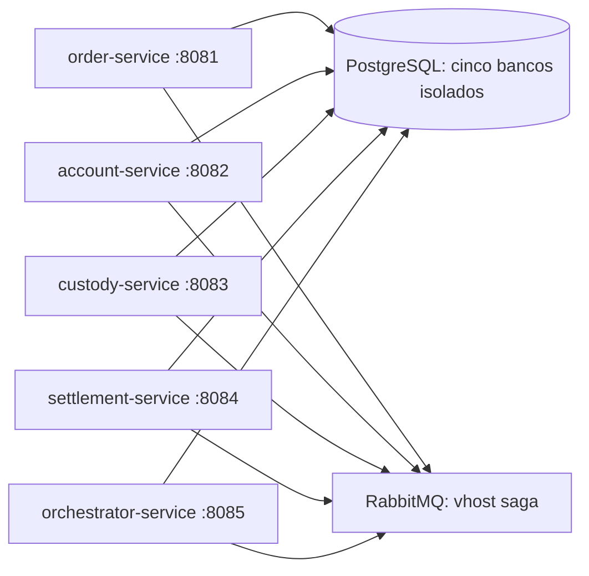

# Executar a modalidade orquestrada

Execute os comandos a partir da raiz do repositório, salvo indicação em contrário.
A API usa loopback para desenvolvimento local e ainda não autentica clientes.

## Executar o bootstrap

Pré-requisitos: JDK 17 completo (Temurin recomendado), Docker Engine/Desktop com
Compose v2 e Bash/curl. No Windows, use Git Bash com Docker Desktop em modo Linux.
Maven global é dispensável: o Wrapper baixa e verifica a distribuição 3.10.0.
Confira `java -version`, `javac -version`, `docker version` e `docker compose version`.
[Versões, checksums e ajustes para esta nuvem](environment.md).

Na raiz do repositório:

```bash
# Preserva um .env que já exista.
test -e infra/.env || cp infra/.env.example infra/.env
# Edite infra/.env e substitua todos os CHANGE_ME por senhas locais distintas.
docker compose --env-file infra/.env -f infra/compose.yaml config --quiet
docker compose --env-file infra/.env -f infra/compose.yaml up -d --wait
bash infra/scripts/configure-rabbitmq.sh
bash infra/scripts/check-database-isolation.sh
cd orquestrada
./mvnw clean verify
cd ..
```

Abra cinco terminais na raiz, configurando o JDK 17 em cada um, e execute **um
comando por terminal**:

```bash
bash infra/scripts/run-service.sh order
bash infra/scripts/run-service.sh account
bash infra/scripts/run-service.sh custody
bash infra/scripts/run-service.sh settlement
bash infra/scripts/run-service.sh orchestrator
```

O script lê seu `.env` local e executa o JAR em primeiro plano. Opcionalmente,
execute `export JAVA_TOOL_OPTIONS='-Xms64m -Xmx256m'` em cada terminal; foi o limite usado
na validação do bootstrap. Não é uma recomendação de capacidade para experimentos.
Aguarde a inicialização e então, em outro terminal na raiz:

```bash
bash infra/scripts/check-health.sh
bash infra/scripts/check-database-isolation.sh
docker compose --env-file infra/.env -f infra/compose.yaml ps
```

Endpoints disponíveis em **cada** porta 8081–8085:

| Caminho HTTP | Resultado esperado |
| --- | --- |
| `/actuator/health` | HTTP 200 e status UP com dependências disponíveis |
| `/actuator/health/liveness` | Estado do processo, independente de banco/broker |
| `/actuator/health/readiness` | Inclui PostgreSQL e RabbitMQ; HTTP 503 se indisponíveis |
| `/actuator/prometheus` | Métricas em formato Prometheus |

A API `/api/ordens` registra e consulta ordens. Sua existência e a confirmação de
saúde não comprovam publicação/consumo de mensagens nem execução da Saga.

## Catálogo demonstrativo

O catálogo padrão começa vazio. Para carregar os ativos `ATV001` (10,00) e
`ATV002` (25,50), versão `demo-v1`, inicie **somente order-service** com:

```bash
SPRING_PROFILES_ACTIVE=demo bash infra/scripts/run-service.sh order
```

Use esse comando no lugar do comando normal de ordens, sem iniciar duas JVMs na
mesma porta. O seed é repetível e não sobrescreve ativos existentes. Mantenha o
perfil `demo` nos reinícios desse banco para preservar a validação do histórico
Flyway. O perfil não cria saldo nem estoque; esses seeds continuam pendentes.

## Criar e consultar uma ordem

Com o catálogo demo e order-service em execução:

```bash
curl -i -X POST http://127.0.0.1:8081/api/ordens \
  -H 'Content-Type: application/json' \
  -H 'Idempotency-Key: compra-exemplo-1' \
  -d '{"clienteId":"CLI001","ativoId":"ATV002","quantidade":3}'
# Use o orderId retornado, ou o caminho informado no cabeçalho Location:
curl http://127.0.0.1:8081/api/ordens/SEU_ORDER_ID
```

A criação retorna `202`, `Location`, orderId, sagaId, estado `RECEBIDA`, preço,
valor total e versão do catálogo. Reenvio com mesmo cliente/chave/conteúdo retorna
a ordem original; conteúdo divergente recebe `409`. Chave ausente ou entrada
inválida recebe `400`; ativo desconhecido, `422`; consulta de ordem inexistente,
`404`. A chave deve ter até 128 caracteres, sem espaços nas extremidades.
A ordem permanece `RECEBIDA` enquanto a coordenação distribuída não existir.

## Encerrar e retomar

Use `Ctrl+C` em cada terminal de aplicação. Em seguida:

```bash
docker compose --env-file infra/.env -f infra/compose.yaml down
```

Os volumes são preservados. Para retomar, execute `up -d --wait` e os cinco comandos
de aplicação novamente. **Não use `down -v` para encerrar:** ele destrói os dados.
Trocar senhas no `.env` não modifica usuários já persistidos nos volumes; consulte
[infra/README.md](../infra/README.md) para o ciclo de vida da configuração.

## Infraestrutura e limites



O diagrama representa conexões de infraestrutura, não um fluxo de Saga implementado.
