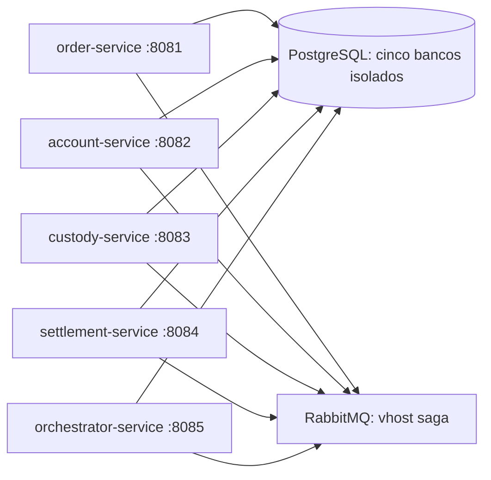

# Executar a modalidade orquestrada

Execute os comandos a partir da raiz do repositório, salvo indicação em contrário.
A API usa loopback para desenvolvimento local e ainda não autentica clientes.

## Executar o bootstrap

Pré-requisitos: JDK 17 completo (Temurin recomendado), Docker Engine/Desktop com
Compose v2, Python 3 e Bash/curl. No Windows, use Git Bash com Docker Desktop em modo Linux.
Maven global é dispensável: o Wrapper baixa e verifica a distribuição 3.10.0.
Confira `java -version`, `javac -version`, `docker version` e `docker compose version`.
[Versões, checksums e ajustes para esta nuvem](environment.md).

Na raiz do repositório:

```bash
# Preserva um .env que já exista.
test -e infra/.env || cp infra/.env.example infra/.env
# Edite infra/.env e substitua todos os CHANGE_ME por senhas locais distintas.
docker compose --env-file infra/.env -f infra/compose.yaml config --quiet
docker compose --env-file infra/.env -f infra/compose.yaml up -d --wait
bash infra/scripts/configure-rabbitmq.sh
bash infra/scripts/check-database-isolation.sh
cd orquestrada
./mvnw clean verify
cd ..
```

Abra cinco terminais na raiz, configurando o JDK 17 em cada um, e execute **um
comando por terminal**:

```bash
bash infra/scripts/run-service.sh order
bash infra/scripts/run-service.sh account
bash infra/scripts/run-service.sh custody
bash infra/scripts/run-service.sh settlement
bash infra/scripts/run-service.sh orchestrator
```

O script lê seu `.env` local e executa o JAR em primeiro plano. Opcionalmente,
execute `export JAVA_TOOL_OPTIONS='-Xms64m -Xmx256m'` em cada terminal; foi o limite usado
na validação do bootstrap. Não é uma recomendação de capacidade para experimentos.
Aguarde a inicialização e então, em outro terminal na raiz:

```bash
bash infra/scripts/check-health.sh
bash infra/scripts/check-database-isolation.sh
docker compose --env-file infra/.env -f infra/compose.yaml ps
```

Endpoints disponíveis em **cada** porta 8081–8085:

| Caminho HTTP | Resultado esperado |
| --- | --- |
| `/actuator/health` | HTTP 200 e status UP com dependências disponíveis |
| `/actuator/health/liveness` | Estado do processo, independente de banco/broker |
| `/actuator/health/readiness` | Inclui PostgreSQL e RabbitMQ; HTTP 503 se indisponíveis |
| `/actuator/prometheus` | Métricas em formato Prometheus |

A API `/api/ordens` registra e consulta ordens. Sua existência e a confirmação de
saúde não comprovam publicação/consumo de mensagens nem execução da Saga.

## Cenário demonstrativo demo-v1

Para usar os dados versionados, inicie ordens, conta e custódia com o perfil
`demo` em três terminais, substituindo os respectivos comandos do bootstrap.

```bash
SPRING_PROFILES_ACTIVE=demo bash infra/scripts/run-service.sh order
SPRING_PROFILES_ACTIVE=demo bash infra/scripts/run-service.sh account
SPRING_PROFILES_ACTIVE=demo bash infra/scripts/run-service.sh custody
```

Em bancos novos, `CLI001` começa com 1.000,00 e `CLI002` com 10,00. A
contraparte de demonstração é `COUNTERPARTY`. Ela possui uma unidade de
`ATV001` (preço 10,00) e dez de `ATV002` (preço 25,50).

| Cenário em bancos novos | Cliente | Ativo | Quantidade | Condição inicial |
| --- | --- | --- | ---: | --- |
| Compra com recursos disponíveis | CLI001 | ATV002 | 3 | Saldo e estoque cobrem 76,50 |
| Saldo insuficiente | CLI002 | ATV002 | 1 | Saldo menor que 25,50 |
| Estoque insuficiente | CLI001 | ATV001 | 2 | Apenas uma unidade disponível |

Cada serviço carrega somente suas próprias migrações. Mantenha o perfil nos
reinícios dos bancos de demonstração. Os seeds preservam preços, saldos e posições
já existentes. Use um conjunto novo de volumes para reproduzir as condições iniciais.
Para parametrizar outro cenário, versione seus SQLs por serviço e selecione o diretório
com `SPRING_FLYWAY_LOCATIONS=classpath:db/migration,filesystem:/caminho/do/seed`
ao iniciar esse serviço.

## Criar e consultar uma ordem

Com os cinco serviços em execução e o perfil demonstrativo em ordens, conta e custódia, crie a compra e consulte seu estado.

```bash
curl -i -X POST http://127.0.0.1:8081/api/ordens \
  -H 'Content-Type: application/json' \
  -H 'Idempotency-Key: compra-exemplo-1' \
  -d '{"clienteId":"CLI001","ativoId":"ATV002","quantidade":3}'
# Use o orderId retornado, ou o caminho informado no cabeçalho Location:
curl http://127.0.0.1:8081/api/ordens/SEU_ORDER_ID
```

A criação retorna `202`, `Location`, orderId, sagaId, estado `RECEBIDA`, preço,
valor total e versão do catálogo. Reenvio com mesmo cliente/chave/conteúdo retorna
a ordem original; conteúdo divergente recebe `409`. Chave ausente ou entrada
inválida recebe `400`; ativo desconhecido, `422`; consulta de ordem inexistente,
`404`. A chave deve ter até 128 caracteres, sem espaços nas extremidades.
O GET começa em `RECEBIDA` e passa a `LIQUIDADA` com o campo `liquidacaoId`
após as duas efetivações. As recusas de saldo e de ativo terminam em `REJEITADA`
com o `motivo` original. Na recusa de ativo, a conta confirma a devolução do saldo
antes da finalização. Repetir o POST com a mesma chave devolve o recibo 202 original,
inclusive depois da conclusão.

## Verificar a compra de ponta a ponta

Use uma instância exclusiva do cenário `demo-v1` e os cinco serviços prontos.
Execute a verificação a partir da raiz do repositório.

```bash
bash infra/scripts/check-happy-path.sh
```

O teste cria a compra do exemplo com a chave fixa `compra-exemplo-1`, aguarda o
GET chegar a `LIQUIDADA` e repete o POST. Ele consulta cada banco com o usuário
correspondente e verifica a correlação entre a ordem, as reservas, a liquidação
e a Saga `CONCLUIDA`. Para essa compra única, a conta termina com 923,50
disponíveis, zero reservado e 76,50 consumidos. A contraparte termina com sete
unidades de `ATV002` e o comprador com três. Reexecutar a verificação recupera a
mesma compra. Outras compras que movimentem esses recursos alteram os totais.

O segundo teste usa a chave `compra-sem-estoque-1` para pedir duas unidades de
`ATV001`, que tem apenas uma disponível. O GET deve retornar `REJEITADA` com
`ATIVO_INSUFICIENTE`. O teste confere a liberação dos 20,00 reservados, o saldo
final igual ao anterior à compra e a ausência de reserva de ativo e de liquidação.

O projeto Maven em `orquestrada/tests` executa essa verificação contra os JARs
em execução. A suíte `clean verify` de `orquestrada/` usa Testcontainers para
os testes de serviço. No teste externo, `ORDER_BASE_URL` configura a URL de
ordens e `SAGA_ENV_FILE` permite indicar um arquivo local com as conexões.

Para acompanhar o estado técnico, substitua o comando de inicialização do
orquestrador pelo comando abaixo, com diagnóstico na interface de loopback. Use o `sagaId` do recibo.

```bash
SAGA_DIAGNOSTICS_ENABLED=true bash infra/scripts/run-service.sh orchestrator
# Em outro terminal
curl http://127.0.0.1:8085/api/sagas/SEU_SAGA_ID
```

O diagnóstico fica desativado por padrão. Quando habilitado, expõe `sagaId`,
`orderId` e `estado`. Na recusa de ativo, a Saga fica em `COMPENSANDO` até receber
as confirmações da conta e de ordens. Na recusa definitiva de liquidação, ela
aguarda primeiro a liberação do ativo e depois a do saldo.

Para reproduzir a retomada de uma execução em trânsito, pare o serviço de
liquidação e crie outra compra com recursos disponíveis e uma chave HTTP nova.
Aguarde `CONFIRMANDO_LIQUIDACAO` no diagnóstico, encerre o coordenador e
reinicie liquidação e coordenador com os mesmos bancos e broker. Confira
`LIQUIDADA` no GET da ordem e `CONCLUIDA` no diagnóstico da mesma Saga.
Faça esse ensaio depois do teste de compra única, pois ele movimenta os recursos
do cenário novamente.

## Verificar a compensação e o reinício

Na raiz, com os cinco JARs construídos, Docker Compose, Bash 4+, curl, jq, Python 3
e o arquivo local `infra/.env` preparado, execute:

```bash
bash infra/scripts/check-recovery.sh
```

O script cria um projeto Compose exclusivo, com volumes novos e portas
automáticas, e inicia os JARs localmente. Ao sair, encerra essas JVMs e remove
o projeto de teste. O cenário usa uma unidade de `ATV002` a 25,50.

1. A liquidação fica desligada até a ordem ter as duas reservas. Ao iniciar,
   `SETTLEMENT_SIMULATION_DENY_ORDER_ID` seleciona aquela ordem para uma recusa
   explícita. O serviço grava `DENIED` e a resposta na mesma transação. A Saga libera
   ativo e saldo, nessa ordem. O teste confere as duas reservas liberadas, os totais
   originais e o GET com `REJEITADA` e `LIQUIDACAO_NEGADA`.
2. Em outra compra, a liquidação confirma e a conta efetiva o saldo. O teste encerra
   a JVM do coordenador com `SIGKILL`, retoma a custódia e descarta no broker de
   teste a resposta de ativo já publicada. Depois do reinício, o reconciliador
   reenvia o comando da etapa pendente. A Inbox de custódia devolve a resposta
   original. O teste verifica uma única liquidação, uma unidade transferida, 25,50
   consumidos e a ordem `LIQUIDADA`.

A opção de simulação fica vazia por padrão. A primeira decisão commitada prevalece
mesmo quando o processo reinicia com outra configuração. O registro `DENIED` fica
em `settlement_decisions`; a tabela `settlements` continua contendo apenas liquidações
confirmadas. Falhas técnicas preservam a operação para nova tentativa.

### Prazos do reconciliador

| Propriedade | Padrão local | Uso |
| --- | --- | --- |
| `saga.timeout.step` | `30s` | Janela para receber resposta após publicação |
| `saga.retry.max-attempts` | `5` | Reenvios antes de sinalizar recuperação pendente |
| `saga.retry.initial-delay` | `1s` | Espera adicional após o primeiro reenvio |
| `saga.retry.max-delay` | `1m` | Limite da espera adicional |
| `reconciliation.poll-interval` | `5s` | Intervalo entre varreduras |
| `reconciliation.batch-size` | `32` | Máximo de etapas por varredura e instância |

Cada tentativa usa o mesmo `operationId`, `messageId`, ordem e Saga. A espera
adicional dobra até o limite. Ao atingir o número configurado de reenvios,
a Saga entra em `RECUPERACAO_PENDENTE` e continua a consultar a operação com
a espera máxima. Uma resposta válida permite avançar. O prazo vencido sozinho
nunca dispara liberação de recursos. Os valores da tabela são padrões de
desenvolvimento e a calibração de carga faz parte do piloto.

## Testar a Inbox dos participantes

Na pasta `orquestrada/`, com JDK 17 e Docker, execute:

```bash
./mvnw -pl account-service,custody-service,settlement-service -am test
```

Testcontainers cria bancos e broker próprios. A suíte de conta exercita dois
consumidores concorrentes, uma falha no commit e a perda do ACK após commit.
As suítes de cada participante verificam a resposta persistida e seu efeito local.

Para acompanhar uma operação no ambiente Compose, conecte-se ao banco do
participante (`accounts_db`, `custody_db` ou `settlements_db`) e, no psql,
substitua o identificador abaixo pelo `operationId` do comando:

```sql
\set operation_id '00000000-0000-0000-0000-000000000000'
SELECT consumer_name, message_id, processed_at
FROM inbox_messages WHERE operation_id = :'operation_id';
SELECT message_id, message_type, envelope, published_at
FROM outbox_messages WHERE operation_id = :'operation_id';
```

Uma operação aceita gera uma resposta durável. Entregas com o mesmo conteúdo e
`operationId` recolocam essa resposta na Outbox com o `messageId` original. A coluna
`published_at` fica nula enquanto a publicação aguarda confirmação. O listener
confirma o comando ao RabbitMQ após o commit local. Formato inválido, identificador
reutilizado com outro conteúdo e conflito com decisão durável seguem para a DLQ
do participante. Antes de reenviar, inspecione o envelope e a operação pela chave
original. Falha técnica ou timeout de liquidação exige recuperação dessa decisão.

## Encerrar e retomar

Use `Ctrl+C` em cada terminal de aplicação. Em seguida:

```bash
docker compose --env-file infra/.env -f infra/compose.yaml down
```

Os volumes são preservados. Para retomar, execute `up -d --wait` e os cinco comandos
de aplicação novamente. **Não use `down -v` para encerrar:** ele destrói os dados.
Trocar senhas no `.env` não modifica usuários já persistidos nos volumes; consulte
[infra/README.md](../infra/README.md) para o ciclo de vida da configuração.

## Infraestrutura e limites



Os serviços trocam comandos e respostas pelo RabbitMQ. Cada transação local usa as credenciais do banco do respectivo serviço.
